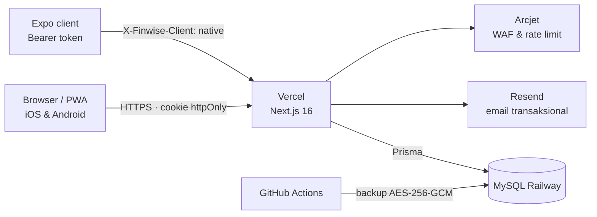

# Finwise

**Catatan keuangan pribadi yang rapi, aman, dan bisa dipakai seperti aplikasi—tanpa perlu beli domain atau rilis ke toko aplikasi.**

[](https://mywallet-virid-eight.vercel.app)
[](https://github.com/kenzobakpo123-cell/mywallet/actions/workflows/ci.yml)
[](https://github.com/kenzobakpo123-cell/mywallet/actions/workflows/backup.yml)


**Demo:** https://mywallet-virid-eight.vercel.app · **Health check:** https://mywallet-virid-eight.vercel.app/api/health

> Demo memakai hostname gratis dari Vercel. Pendaftaran di production sengaja dibatasi oleh `ALLOWED_EMAILS`, jadi pengunjung umum tidak bisa membuat akun. Untuk mencoba alur lengkapnya, jalankan proyek secara lokal dengan email kamu sendiri—caranya ada di bawah.

---

## Masalah yang ingin diselesaikan

Catatan keuangan sering kali berakhir di spreadsheet yang ribet dibuka dari HP, atau di aplikasi yang menyimpan data sensitif tanpa kontrol yang jelas. Finwise menyatukan semuanya dalam satu dashboard yang:

- enak dipakai di desktop **dan** layar HP;
- bisa dipasang ke layar utama lewat PWA (tidak perlu App Store/Play Store);
- punya alur akun yang aman: verifikasi email, 2FA, sesi per perangkat, dan audit aktivitas;
- tetap bisa di-deploy dengan biaya rendah memakai hostname gratis Vercel.

Singkatnya: ini bukan sekadar CRUD transaksi. Fokusnya adalah **produk yang bisa dipakai sehari-hari + rekayasa keamanan dan operasional yang masuk akal untuk produksi**.

---

## Fitur utama

| Area | Yang bisa dilakukan |
| --- | --- |
| **Ringkasan** | Lihat saldo saat ini, pemasukan/pengeluaran bulan berjalan, net flow, dan pengeluaran per kategori. |
| **Transaksi** | Tambah, ubah, dan hapus pemasukan/pengeluaran. Filter berdasarkan rentang tanggal, kategori, dan kata kunci. |
| **Dompet & kategori** | Kelola beberapa dompet dan kategori; saldo awal dompet ikut dihitung ke saldo keseluruhan. |
| **Anggaran** | Pasang anggaran bulanan dengan penanda **Hampir habis** (≥80%) dan **Melewati batas** (≥100%). |
| **Ekspor data** | Unduh seluruh riwayat ke **CSV** atau **PDF**. Filter aktif ikut dipakai; batas aman 20.000 baris per berkas. |
| **Preferensi** | Atur nama, zona waktu, dan mata uang. Tanggal "hari ini" mengikuti zona waktu pengguna, bukan UTC server. |
| **Sinkronisasi** | Perubahan antartab sinkron lewat `BroadcastChannel` + refresh otomatis tiap 30 detik saat tab aktif. |
| **Klien HP** | Klien Expo contoh bisa menambah/ubah/hapus transaksi, pull-to-refresh, dan login memakai Bearer token. |
| **Reset data** | Hapus seluruh data keuangan dan sesi dengan konfirmasi ketik `RESET`; akun, email, password, dan preferensi tetap tersimpan. |

### PWA di iOS & Android

Buka demo di HP, lalu:

- **Android (Chrome):** menu `⋮` → **Install app** / **Add to Home screen**.
- **iOS (Safari):** tombol **Bagikan** → **Tambahkan ke Layar Utama**.

Safari tidak memicu prompt unduh otomatis, jadi aplikasi menampilkan pengingat ringkas khusus iOS. Ikon Finwise lalu muncul di layar utama dan dibuka seperti aplikasi biasa.

> Service worker hanya menyimpan aset tampilan dan halaman cadangan offline. Data keuangan, cookie, dan token **tidak pernah** dimasukkan ke cache.

---

## Arsitektur



Beberapa keputusan desain yang sengaja diambil:

- **Vercel + Railway:** Vercel menjalankan Next.js dan migrasi otomatis saat build; MySQL Railway dipakai lewat TCP proxy publik. Host internal `mysql.railway.internal` tidak dipakai karena tidak bisa dijangkau dari serverless Vercel.
- **Tanpa domain berbayar:** URL `*.vercel.app` sudah HTTPS dengan sertifikat otomatis. Domain sendiri opsional dan tidak diperlukan untuk mulai.
- **Token terpisah per klien:** web hanya menyimpan token di cookie `httpOnly`; klien native memakai endpoint khusus dengan Bearer token di `expo-secure-store`.
- **Tautan email deterministik:** `APP_URL` dibaca dari konfigurasi, bukan dari header `Host`/`Origin` request.
- **Rate limit bersama:** endpoint kritis memakai tabel `RateLimit` di database agar pembatasan tetap konsisten di banyak instance serverless.

---

## Keamanan berlapis

| Lapisan | Implementasi |
| --- | --- |
| **Pendaftaran** | Allowlist `ALLOWED_EMAILS` bersifat *fail-closed* di production + verifikasi email wajib. |
| **Password** | Password baru minimal 12 karakter, ditolak bila terlalu umum/angka saja; hash memakai `bcryptjs`. |
| **Sesi** | Token akses 15 menit, refresh token 30 hari disimpan sebagai hash SHA-256 dan diputar atomik; replay terdeteksi. |
| **2FA** | TOTP SHA-1 6 digit/30 detik, rahasia dienkripsi AES-GCM, 8 kode pemulihan sekali pakai tersimpan sebagai hash. |
| **2FA wajib** | `REQUIRE_2FA_EMAILS` memaksa authenticator dipasang sebelum sesi dibuat—termasuk saat reset password. |
| **CSRF** | Mutation web menolak request tanpa `Origin` yang sah; klien native memakai header khusus + Bearer. |
| **Respons insiden** | 3 password salah → sesi dicabut otomatis; notifikasi email untuk login gagal, lockout, dan perubahan 2FA. |
| **WAF & limit** | Arcjet + rate limit berbasis database untuk login, 2FA, reset password, dan endpoint sensitif. |
| **Audit** | Riwayat login, perubahan profil/anggaran, 2FA, reset, dan lockout bisa dilihat dari menu **Lihat aktivitas**. |
| **Database** | User aplikasi dengan hak minimum; `root` hanya untuk administrasi/migrasi darurat. |
| **Backup** | Backup terenkripsi AES-256-GCM tiap 01:00 WIB, artefak GitHub disimpan 90 hari. |

Detail prosedur rotasi secret dan respons insiden ada di [`docs/SECURITY-RUNBOOK.md`](docs/SECURITY-RUNBOOK.md).

---

## Kualitas & pengujian

- `npm run lint`, `tsc`, dan `next build` hijau.
- **96 test** Vitest mencakup autentikasi, 2FA, CSRF, rate limit, ekspor CSV/PDF, tanggal & zona waktu, dan manifest PWA.
- `npm audit` melaporkan **0 kerentanan**.
- GitHub Actions menjalankan `lint → test → migrate → build` pada setiap push dan pull request.
- Dependabot memperbarui dependency npm dan GitHub Actions tiap minggu.
- Health check produksi: `GET /api/health`.

---

## Stack

| Bagian | Teknologi |
| --- | --- |
| UI & server | Next.js 16 (App Router), React 19, TypeScript |
| Database | MySQL, Prisma 6, migrasi versi |
| Auth & kripto | `jose`, `bcryptjs`, TOTP, AES-GCM, SHA-256 |
| Validasi | Zod 4 |
| Email & proteksi | Resend, Arcjet |
| Test | Vitest 5 |
| Deploy | Vercel, Railway MySQL, GitHub Actions |
| Mobile | Referensi klien Expo + `expo-secure-store` |

---

## Menjalankan secara lokal

```powershell
git clone https://github.com/kenzobakpo123-cell/mywallet.git
cd mywallet
npm install
copy .env.example .env
# Isi DATABASE_URL, JWT_SECRET, dan APP_URL=http://localhost:3000 di .env
npm run db:migrate
npm run dev
```

Buka http://localhost:3000 lalu daftar memakai email yang tercantum di `ALLOWED_EMAILS`.

Tanpa `RESEND_API_KEY`, tautan verifikasi dan reset password dicetak di terminal, jadi alur tetap bisa dicoba. File `.env` sudah masuk `.gitignore` dan tidak pernah di-commit.

Panduan lengkap—termasuk Docker, klien Expo, deploy Vercel, dan backup—ada di [`docs/SETUP.md`](docs/SETUP.md).

---

## Struktur singkat

```text
app/                 Halaman dashboard + route API
components/          UI, auth screen, icon, PWA register
lib/                 Auth, database, keamanan, ekspor, preferensi
prisma/              Schema dan riwayat migrasi
mobile/App.tsx       Contoh klien Expo (Bearer + secure store)
tests/               Vitest
.github/workflows/   CI dan backup terenkripsi
docs/                Setup & security runbook
```

---

## Dibangun oleh

**[kenzobakpo123-cell](https://github.com/kenzobakpo123-cell)** — repo ini disusun sebagai portofolio: dari desain produk, implementasi backend/frontend, hardening keamanan, sampai operasional produksinya.

Kalau kamu mau diskusi soal arsitektur, keamanan, atau pendekatan PWA-nya, silakan buka Issues di repository ini.
